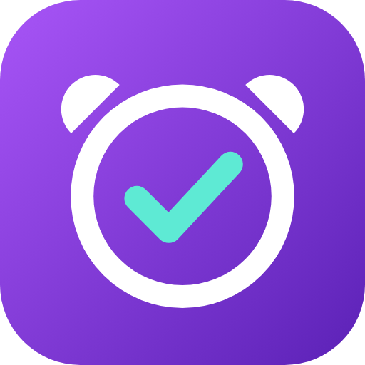
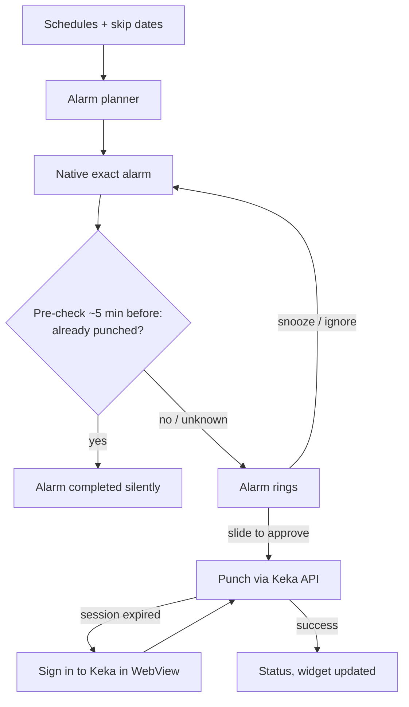

<p align="center">
  
</p>

<h1 align="center">ClockMate</h1>

<p align="center">
  Rings like an alarm and clocks you in and out of Keka after you approve.
</p>

<p align="center">
  
  
  
</p>

---

Forgetting to clock in or out is easy. ClockMate makes it hard: at the times you choose, it rings like a real alarm, and one slide punches your attendance in Keka for you. If you have already punched (in the Keka app, on the web, or anywhere else), it notices and stays quiet.

> [!WARNING]
> **Unofficial.** ClockMate is not affiliated with or endorsed by Keka. It talks to Keka's **undocumented** web-app API, which can change without notice. Use it at your own risk and within your employer's attendance policy.

## Features

- **Separate clock-in and clock-out schedules.** Pick a time and the weekdays for each (defaults: 09:30 and 18:30, Monday to Friday).
- **Skip dates.** Mark leave days and holidays so nothing rings.
- **A real alarm.** It rings with sound and vibration and has a slide-to-approve punch. You also get snooze presets (10 and 30 min), custom snooze, repeat reminders when ignored, and an optional cap on reminders.
- **Pre-check.** About 5 minutes before an alarm, ClockMate quietly checks Keka. If today's attendance already covers it, the alarm never rings. If the check fails for any reason, the alarm still rings, because a needless alarm beats a missed punch.
- **Sign in once.** You log in to Keka in an in-app WebView and ClockMate captures the session token. The token is refreshed silently in a headless WebView. If the login has fully expired, you're asked to sign in again and the pending punch finishes right after.
- **Today screen and home-screen widgets** show your current status (clocked in since…, last clock-out) on Android and iOS.
- **Debug tools.** You can browse Keka inside the app and inspect a request log to confirm the endpoints on your account.

## How it works



Everything Keka-specific lives in [`lib/features/keka/keka_endpoints.dart`](lib/features/keka/keka_endpoints.dart). If Keka changes its API, that file is the place to update.

## Platform notes

### Android

- Uses `AlarmManager.setAlarmClock` exact alarms, which survive Doze and show the alarm icon in the status bar.
- A foreground ring service shows a full-screen alarm over the lock screen.
- Alarms are rescheduled after a reboot.
- Permissions requested:

  | Permission | Why |
  | --- | --- |
  | `USE_EXACT_ALARM` / `SCHEDULE_EXACT_ALARM` | Ring at the exact time |
  | `POST_NOTIFICATIONS`, `USE_FULL_SCREEN_INTENT`, `SYSTEM_ALERT_WINDOW` | Show the alarm over the lock screen |
  | `FOREGROUND_SERVICE*`, `WAKE_LOCK`, `VIBRATE` | Keep ringing reliably |
  | `RECEIVE_BOOT_COMPLETED` | Restore alarms after a reboot |
  | `REQUEST_IGNORE_BATTERY_OPTIMIZATIONS` | Stop the OS from killing alarms |
  | `ACCESS_FINE/COARSE_LOCATION` | Keka's web app may ask for location when you punch |
  | `INTERNET` | Talk to Keka |

### iOS

- On **iOS 26+**, alarms use **AlarmKit**, so they ring like the Clock app: on the lock screen, through silent mode and Focus.
- The home-screen widget needs a **one-time Xcode setup** and a paid Apple developer team, because it shares data through an App Group. See [`ios/WIDGET_SETUP.md`](ios/WIDGET_SETUP.md).

## Tech stack

- **Flutter / Dart 3** with **Riverpod 3** for state
- `flutter_inappwebview`: Keka sign-in, token capture, silent refresh
- `flutter_secure_storage`: session token storage
- `shared_preferences`, `sqflite`: settings and local data
- `home_widget`: Android and iOS widgets
- `http`, `intl`, `slide_to_act`
- Native: **Kotlin** (alarm engine, ring service, pre-check, widget) and **Swift** (AlarmKit backend, WidgetKit extension)
- Font: [Inter](https://rsms.me/inter/) (SIL Open Font License)

## Getting started

### Prerequisites

- Flutter SDK with Dart `^3.13.4`
- Android Studio / Android SDK (device or emulator on Android 8.0+)
- Xcode and CocoaPods for iOS (iOS 15+; AlarmKit alarms need iOS 26+)

### Run

```bash
git clone <repo-url>
cd clockmate
flutter pub get
flutter run
```

On first launch, go to **Settings → Connect Keka**, sign in to your company's Keka (`https://<company>.keka.com`), then turn on your clock-in and clock-out schedules.

### Release build (Android)

```bash
flutter build apk --release
```

Release builds are signed with `android/key.properties` when that file exists. Otherwise they fall back to debug signing. Create it locally and **never commit it** (it and `*.jks` are already gitignored):

```properties
storePassword=<your-store-password>
keyPassword=<your-key-password>
keyAlias=<your-key-alias>
storeFile=<path-to-your-keystore.jks>
```

## Releases

Every pull request into `main` runs [`.github/workflows/ci.yml`](.github/workflows/ci.yml), which runs `flutter analyze` and `flutter test`.

Every merge to `main` runs [`.github/workflows/release.yml`](.github/workflows/release.yml). It analyzes and tests the code, builds Android and iOS, and publishes a [GitHub Release](../../releases) tagged `v<version>-build.<n>`. Each release has:

- `ClockMate-….apk`: install directly on Android
- `ClockMate-….aab`: an App Bundle for Google Play
- `ClockMate-…-unsigned.ipa`: an unsigned iOS build to sideload (AltStore, Sideloadly) or re-sign with your own team
- `SHA256SUMS.txt`

The version name comes from `version:` in `pubspec.yaml`, and the build number is the workflow run number.

### Android signing secrets

Add these under **Settings → Secrets and variables → Actions** so release APKs are signed with your key. Without them, CI signs with a throwaway debug key, and each new APK won't install over the previous one.

| Secret | Value |
| --- | --- |
| `ANDROID_KEYSTORE_BASE64` | `base64 -i android/clockmate-release.jks \| pbcopy` |
| `ANDROID_KEYSTORE_PASSWORD` | `storePassword` from `key.properties` |
| `ANDROID_KEY_ALIAS` | `keyAlias` |
| `ANDROID_KEY_PASSWORD` | `keyPassword` |

## Project structure

```
lib/
├── main.dart
├── app/            # shell, navigation, theme, shared widgets, formatting
├── core/           # secure storage
└── features/
    ├── alarm/      # alarm planner, controller, platform bridge, ring screen
    ├── home/       # today screen, account sheet
    ├── keka/       # API, endpoints, login WebView, token sniffer/refresher, debug log
    ├── native_sync/# mirrors session/status/widget data to native code
    ├── schedule/   # clock-in/out schedules
    └── settings/   # settings model, controller, screen
android/app/src/main/kotlin/…   # AlarmEngine, RingService, PreCheck, widget
ios/Runner/                     # AlarmKitBackend, AlarmBridge
ios/ClockMateWidget/            # WidgetKit extension
test/                           # unit tests
tool/app_icon/                  # app icon generator
```

## Testing

```bash
flutter test
```

Tests cover the alarm planner, the settings and schedules, and Keka response parsing.

## Privacy

- Your Keka session token stays **on your device**, in secure storage.
- The debug request log never captures headers, so the token never appears in it.
- ClockMate talks only to your company's Keka host. It has no servers, analytics, or third-party tracking.

## License

No license has been chosen yet. Until a `LICENSE` file is added, all rights are reserved.

The Inter font is bundled under the [SIL Open Font License](assets/fonts/Inter-OFL.txt).
